# 软件工程概论 · 实践作业

提交人：yuanshiwen　日期：2026-11-11

## 实践课1：Pi Agent 安装与使用

- 报告正文：[practice-01/README.md](practice-01/README.md)
- 截图目录：[screenshots/](screenshots/)（S1–S10，共 15 张）
- 附带文件：[practice-01/files/](practice-01/files/)（`hello.py`、`paste-image-test.png`）、[practice-01/pptx/](practice-01/pptx/)（`skills/pptx` 副本）、[practice-01/out/](practice-01/out/)（两页 PPT、生成脚本、渲染图）
- 作业 Issue：#1

环境：Windows 11，Windows Terminal，PowerShell 7，Pi 1.5.2，DeepSeek 提供商（API Key）。

## 一、安装与启动

在 `pi-test` 目录执行 `pi`。版本 1.5.2，底部状态栏显示工作目录 `D:\CodexProject\软件工程概论\Pi agent\pi-test` 与模型 `deepseek-v4-pro · high`。

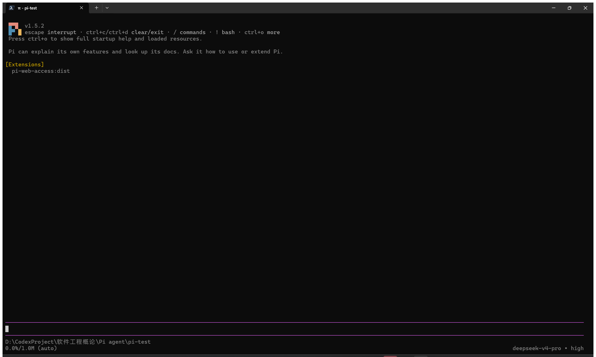

## 二、一次模型会话

提示词「你好，请用一句话介绍你自己。」与模型回复。

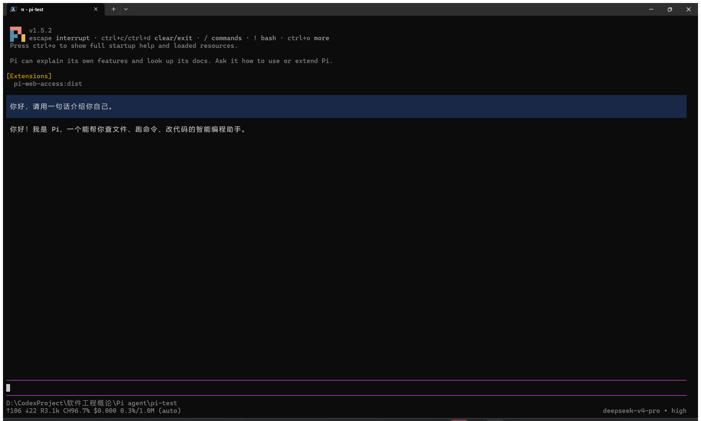

## 三、切换模型与思考级别

先用 `/model` 把 `deepseek-v4-pro` 换成 `deepseek-flash`，再用 `/thinking` 把思考级别从 `high` 降到 `low`；每次切换后都发一句短问题确认会话正常。

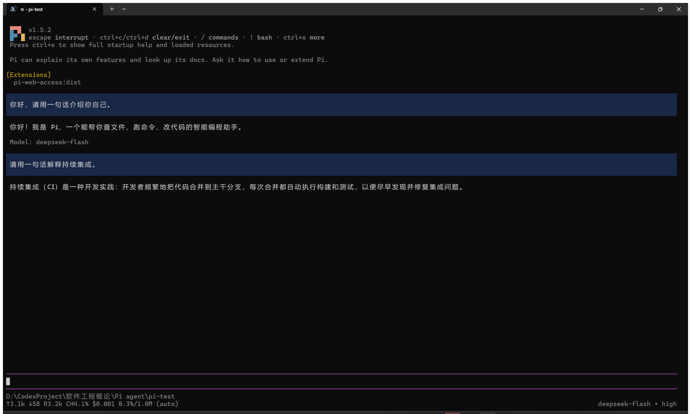

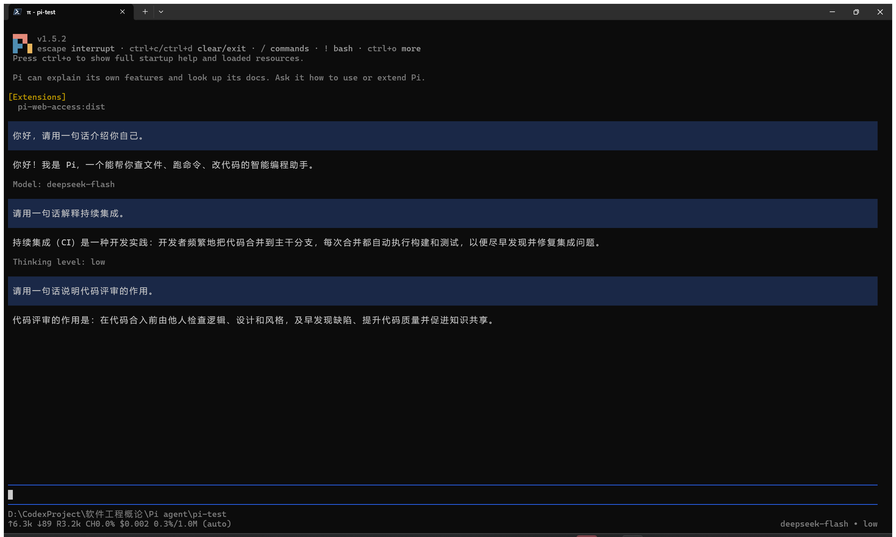

## 四、引用代码文件与图片输入

用 `@` 在候选列表中选中 `hello.py`，提问后 Pi 调用 `read` 读取文件并解释 `add(a, b)`，指出输出为 5。

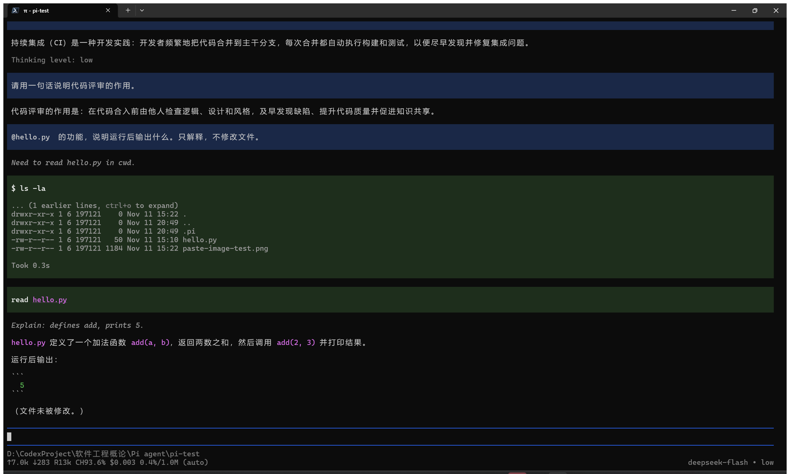

测试图为 200×200 的浅蓝底方块加白色数字 7（原图见 [practice-01/files/paste-image-test.png](practice-01/files/paste-image-test.png)）。用 `Alt+V` 粘贴后 Pi 将其存为临时文件，识别结果为浅蓝色正方形与居中的白色数字 7。

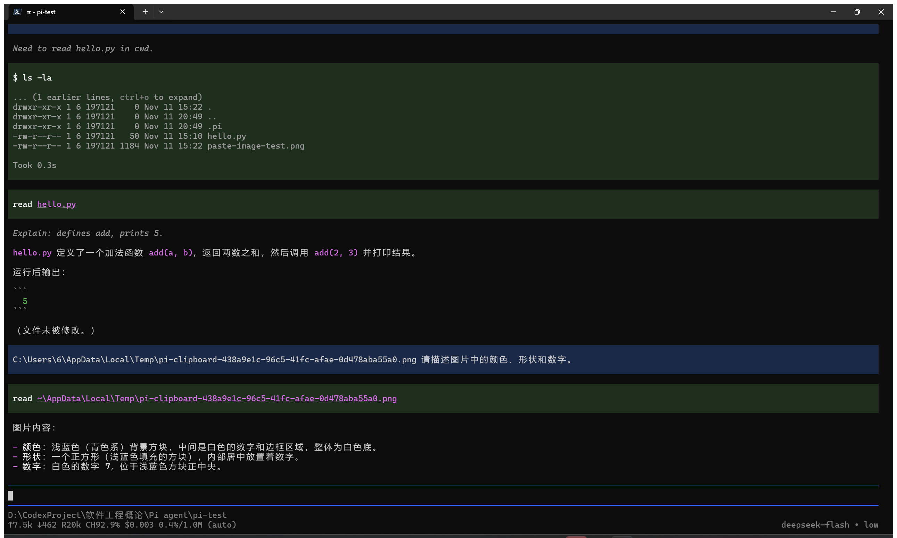

## 五、插件 pi-web-access

`pi install npm:pi-web-access -l`（项目级）。为取得安装输出，先移除再重新安装。

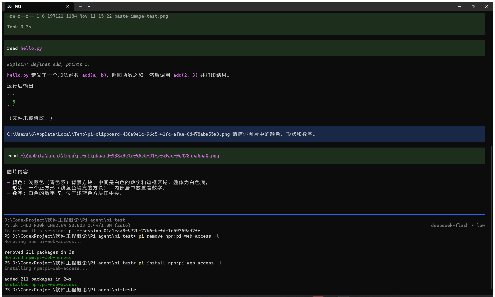

退出会话后单独运行 `pi`，Extensions 区域列出 `pi-web-access:dist`。

调用网页搜索：3 条查询、15 个来源（provider: exa），返回 pi.dev 文档、Quickstart、Command Line 三个链接。同一扩展的网页抓取被其内置 SSRF 防护拦截，本次没有取得抓取结果。

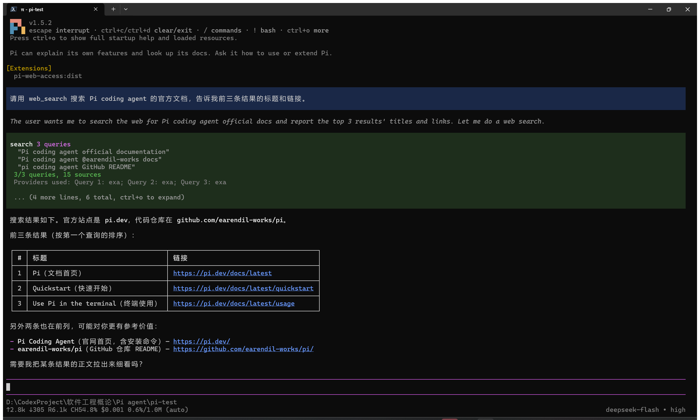

## 六、PPT Skill 与两页 PPT

`skills/pptx` 装在项目 `.pi\skills\pptx`，源 commit `2c5958ecac7cee2b583967a2c4981d0f4a75c579`。

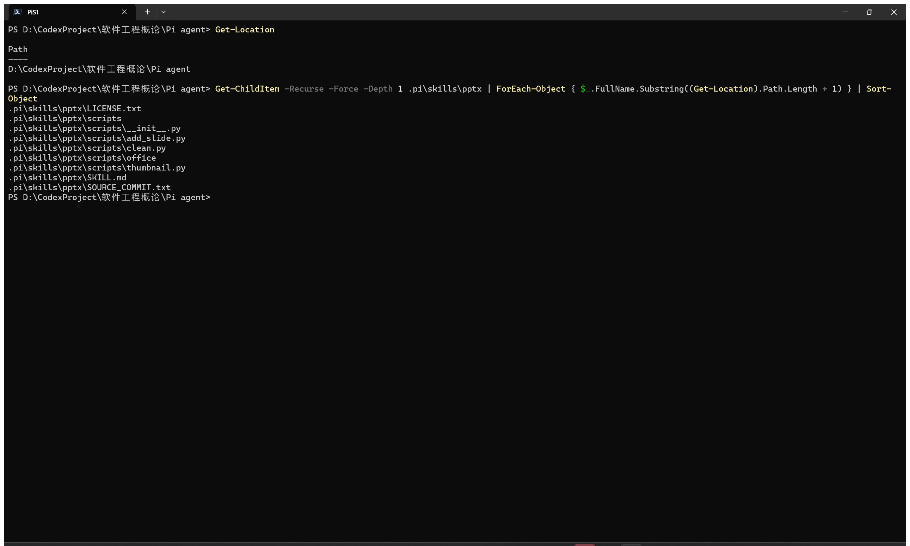

在该目录重启 `pi`，Skills 区域列出 `pptx`。

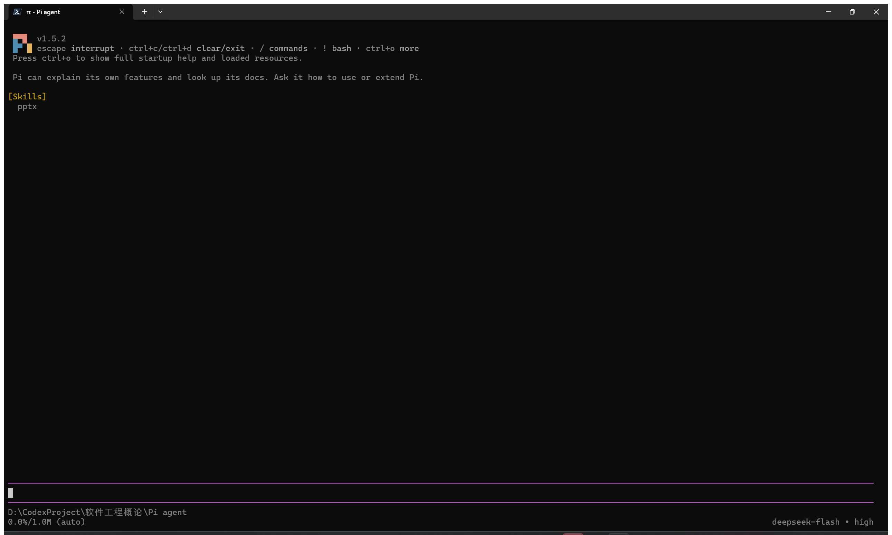

`/skill:pptx 请说明这个 Skill 的名称、用途和所在目录。` 的回复给出名称、目录与三类用法。

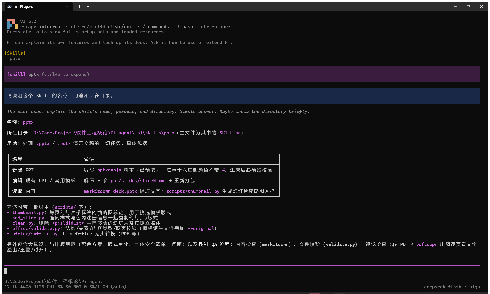

选做项用 pptxgenjs 生成两页 PPT，产物为 [practice-01/out/pi-practice.pptx](practice-01/out/pi-practice.pptx)（60,540 字节，13.33×7.5 in）。核查用了三个工具：`validate.py` 输出 All validations PASSED；`python-pptx` 读出 2 页；LibreOffice 渲染 pageCount 2、missingFonts 0。

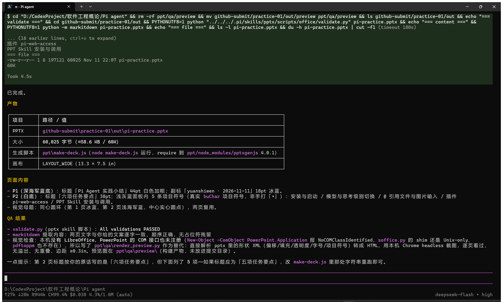

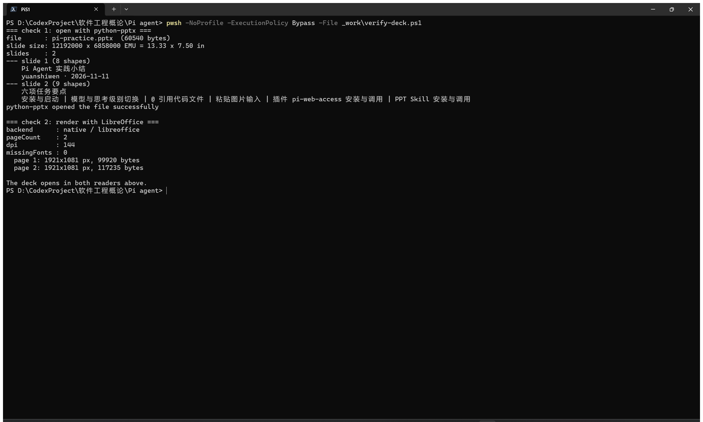

两页渲染结果（文件位于 `practice-01/out/`）：

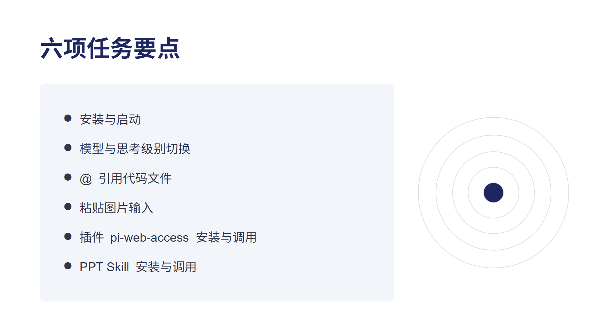
