# 实践课1：Pi Agent 安装与使用

姓名拼音：yuanshiwen
日期：2026-11-11
环境：Windows 11，Windows Terminal，PowerShell 7，Pi 1.5.2，DeepSeek 提供商（API Key 方式）

## 一、安装与启动

安装命令取自项目官方 README：

```powershell
powershell -c "irm https://pi.dev/install.ps1 | iex"
```

新建练习目录 `pi-test`，在其中执行 `pi` 启动。


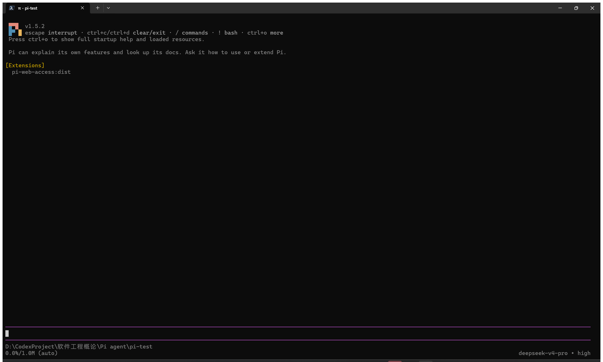

## 二、模型配置与一次会话

`/login` → `Sign in with an API key` → 选择 DeepSeek，填入在 DeepSeek API Platform 创建的密钥。发送提示词「你好，请用一句话介绍你自己。」，收到回复「你好！我是 Pi，一个能帮你查文件、跑命令、改代码的智能编程助手。」

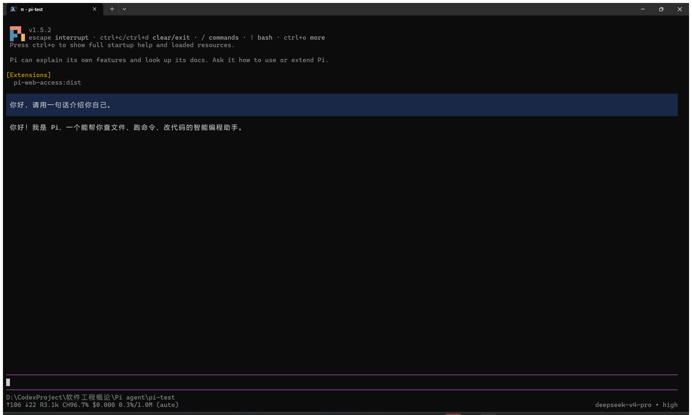

## 三、模型与思考级别切换

| 顺序 | 操作 | 操作后的状态 | 回复情况 |
| --- | --- | --- | --- |
| 1 | 初始 | `deepseek-v4-pro · high` | 「你好」一轮正常 |
| 2 | `/model` 筛选 `flash` 后回车 | `deepseek-flash · high` | 问「请用一句话解释持续集成。」，回复正常 |
| 3 | `/thinking` 选 `low` | `deepseek-flash · low` | 问「请用一句话说明代码评审的作用。」，回复正常 |

选择 flash 的原因：这一步只需回答概念性的短问题；v4-pro 的思考级别只有 `high` 和 `max` 两档，留给需要更复杂推理的场合。`deepseek-flash` 的思考级别有 `off / low / high / max`。


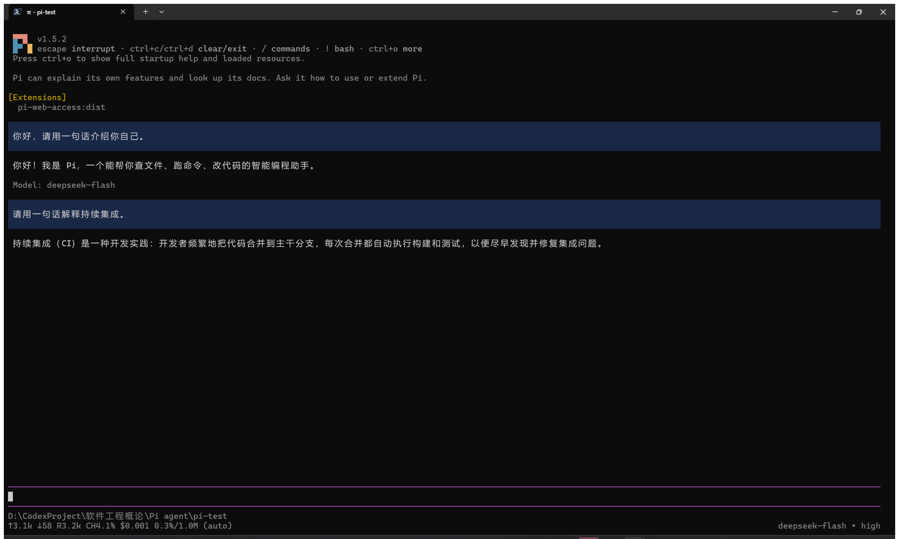

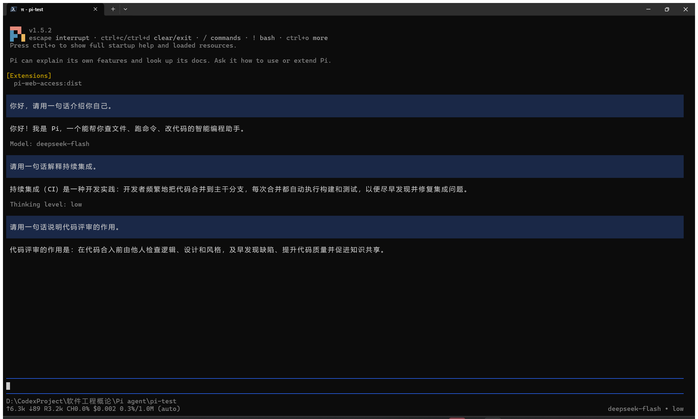

## 四、引用代码文件与图片输入

### A 用 @ 引用 hello.py

```python
def add(a, b):
    return a + b

print(add(2, 3))
```

在输入区键入 `@` 打开候选列表，继续键入 `hello` 过滤，选中 `hello.py` 回车，再输入问题「…的功能，说明运行后输出什么。只解释，不修改文件。」

Pi 先执行 `ls -la`，再调用 `read hello.py`，回复说明 `add` 是加法函数、运行后输出 `5`，并注明文件未被修改。

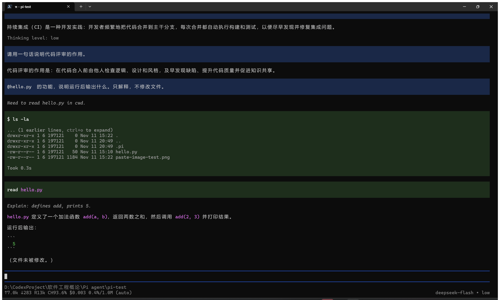

### B 粘贴图片

测试图为 200×200 的浅蓝色方块，中央是白色数字 7：


把图片放入剪贴板后在输入区按 `Alt+V`，Pi 将图片存为临时文件并在输入框显示路径；随后输入「请描述图片中的颜色、形状和数字。」，Pi 读取该文件并回复：浅蓝色背景方块、正方形、白色数字 7 居中。

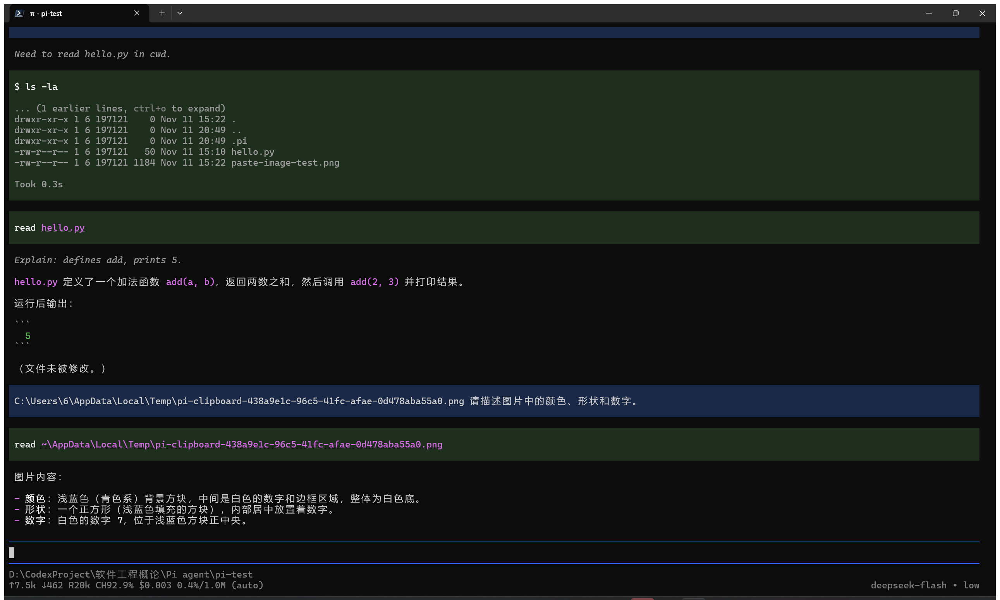

## 五、插件 pi-web-access

| 项目 | 内容 |
| --- | --- |
| 包名 | `pi-web-access@0.47.0`（npm） |
| 来源 | https://pi.dev/packages ；仓库 https://github.com/nicobailon/pi-web-access ，作者 Nico Bailon，MIT |
| 作用 | 为 Pi 增加联网能力：网页搜索、URL 抓取、GitHub 仓库与 Issue 读取、PDF 提取、视频理解 |
| 安装命令 | `pi install npm:pi-web-access -l`（项目级，装在 `pi-test`） |

为取得安装输出，先 `pi remove npm:pi-web-access -l` 再重新安装，输出为 `added 211 packages in 24s` / `Installed npm:pi-web-access`。

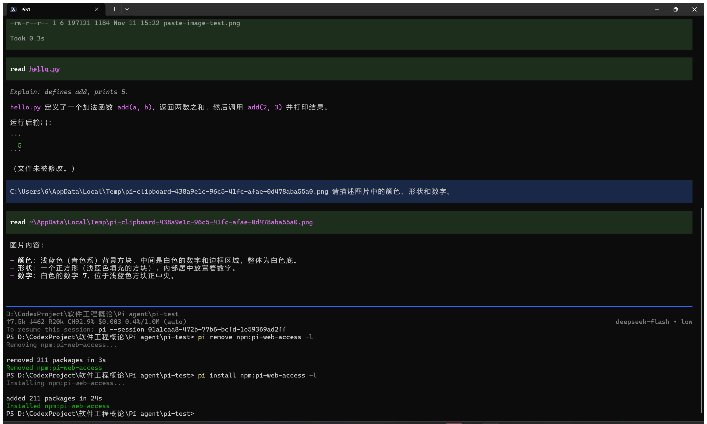

退出会话后单独运行 `pi`，启动画面的 `[Extensions]` 区域列出 `pi-web-access:dist`。


调用一次搜索：「请用 web_search 搜索 Pi coding agent 的官方文档，告诉我前三条结果的标题和链接。」扩展工具 `search` 发起 3 条查询、取得 15 个来源（provider: exa），返回 `pi.dev` 文档、Quickstart、Command Line 三个链接。

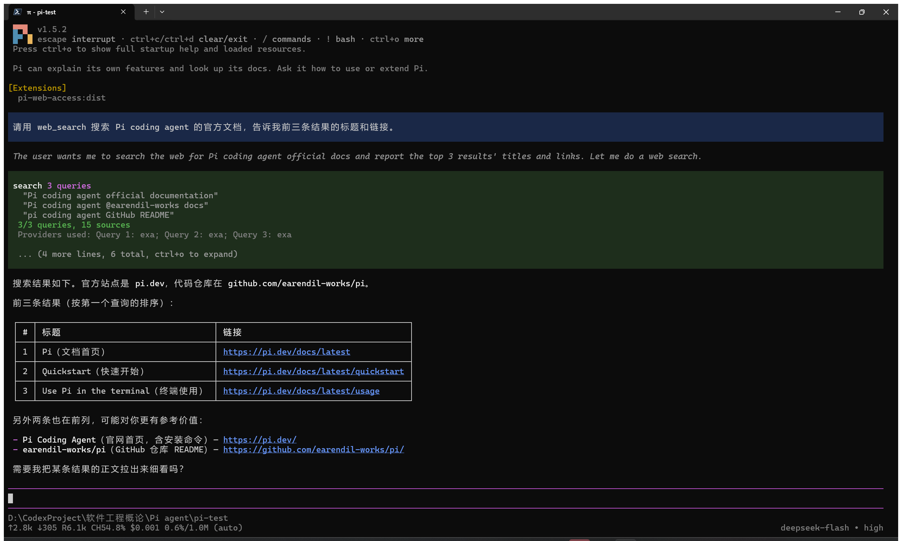

同一扩展的网页抓取（fetch）在本机被其内置的 SSRF 防护拦截，本次未取得抓取结果。

## 六、PPT Skill

### 安装与发现

| 项目 | 内容 |
| --- | --- |
| 来源 | https://github.com/anthropics/skills 的 `skills/pptx` |
| 源 commit | `2c5958ecac7cee2b583967a2c4981d0f4a75c579`（记在 `.pi/skills/pptx/SOURCE_COMMIT.txt`） |
| 安装位置 | `D:\CodexProject\软件工程概论\Pi agent\.pi\skills\pptx` |
| 内容 | `SKILL.md`、`LICENSE.txt`、`SOURCE_COMMIT.txt`、`scripts/`（`add_slide.py`、`clean.py`、`thumbnail.py`、`office/` 下的校验脚本与 OOXML schemas） |

完整副本另存于本仓库 `practice-01/pptx/`。

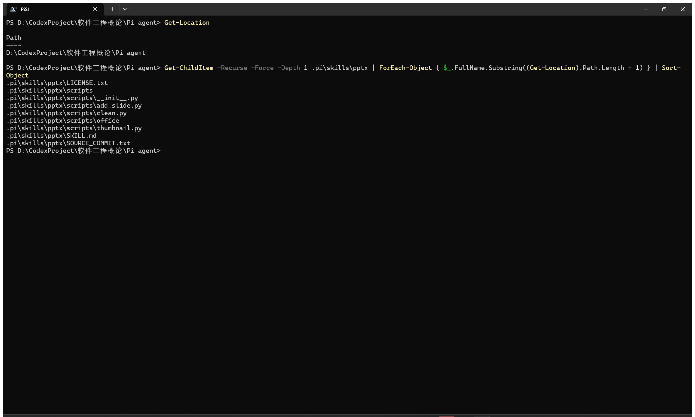

在该目录重新启动 `pi`，启动画面 `[Skills]` 区域列出 `pptx`。

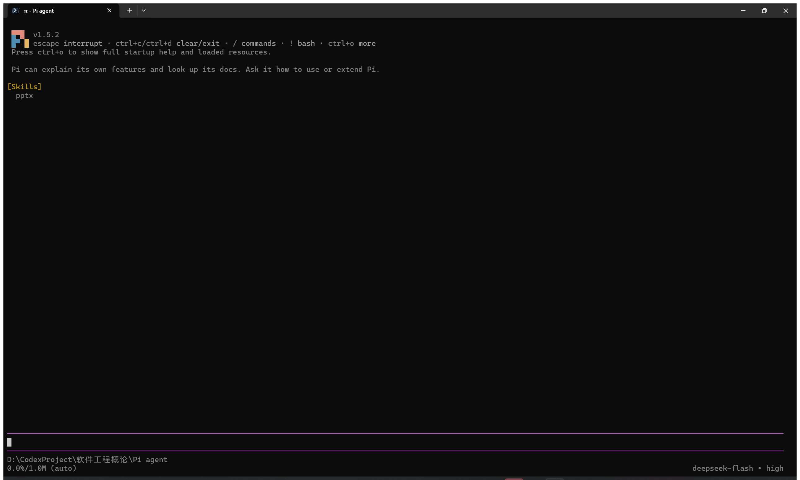

输入 `/skill:pptx 请说明这个 Skill 的名称、用途和所在目录。`，回复给出名称 `pptx`、目录 `D:\CodexProject\软件工程概论\Pi agent\.pi\skills\pptx`（主文件 `SKILL.md`），以及新建（pptxgenjs 脚本）、编辑（解压改 XML 再打包）、读取（markitdown / `thumbnail.py`）三类用法。

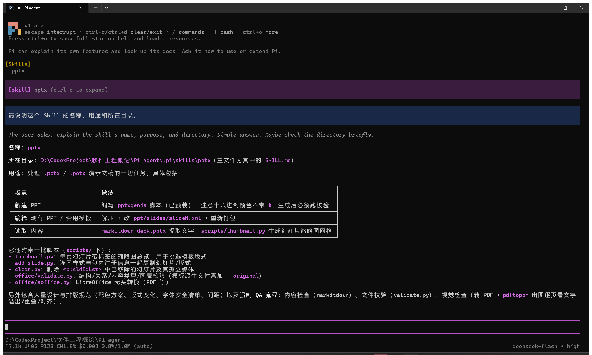

### 选做：生成两页 PPT 并核查可打开

生成前先确认依赖。Skill 文本假设的工具本机并不齐全：

| 依赖 | 本机状态 | 处理 |
| --- | --- | --- |
| Node.js | v24.18.0 已装 | 直接使用 |
| pptxgenjs | 未安装 | `npm install pptxgenjs`，装到 4.0.1 |
| python-pptx、defusedxml、lxml、markitdown | 系统 Python 缺失 | 会话内 `python -m pip install defusedxml lxml "markitdown[pptx]"` |
| LibreOffice、pdftoppm | 均未安装；`scripts/office/soffice.py` 的 shim 只适用于 Unix | 视觉检查改用另写的 OOXML 解析预览器 |

产物：

| 文件 | 说明 |
| --- | --- |
| `practice-01/out/pi-practice.pptx` | 两页，60,540 字节，画布 13.33×7.5 in |
| `practice-01/out/make-deck.js` | pptxgenjs 生成脚本（`node make-deck.js` 可复现） |
| `practice-01/out/pi-practice-slide-1.png`、`-2.png` | 两页整页渲染图 |

第 1 页为深蓝底标题页（标题「Pi Agent 实践小结」，副标题「yuanshiwen · 2026-11-11」）；第 2 页为白底列表页（标题「六项任务要点」，6 条项目符号）。第 2 页首版只列 5 条，重新生成后改为 6 条，与标题对应。

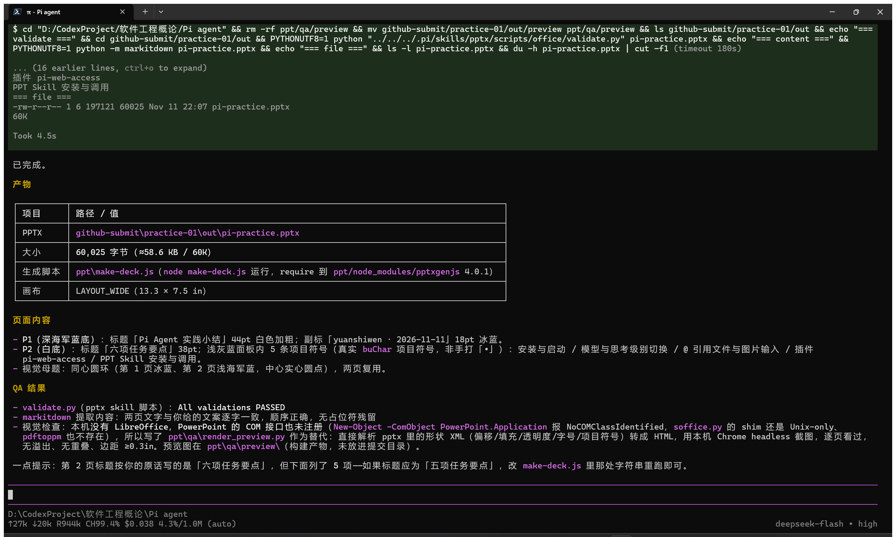

核查用了两个互相独立的读取实现，加上 Skill 自带的校验脚本：

- `scripts/office/validate.py`：`All validations PASSED`（schema、关系、content-type、幻灯片检查）
- `python-pptx`：`slides: 2`，画布 `12192000 × 6858000 EMU = 13.33 × 7.50 in`，两页文字完整读出
- LibreOffice：`pageCount 2`、`missingFonts 0`，两页渲染成功（1921×1081）

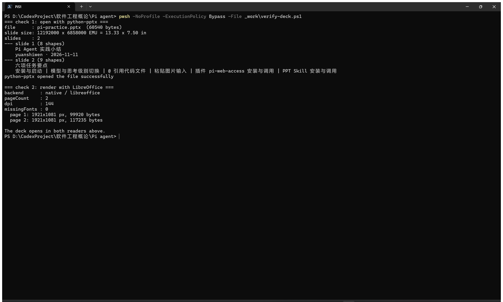

## 仓库文件

| 路径 | 内容 |
| --- | --- |
| `screenshots/` | S1–S10 共 15 张截图 |
| `practice-01/README.md` | 本报告 |
| `practice-01/files/` | `hello.py`、`paste-image-test.png` |
| `practice-01/pptx/` | `skills/pptx` 完整副本 |
| `practice-01/out/` | 两页 PPT、生成脚本、渲染图 |
